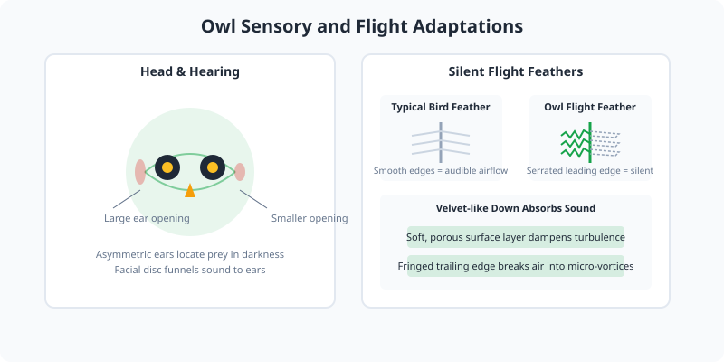

Owls are nocturnal birds of prey characterized by large forward-facing eyes, a facial disc that directs sound to their ears, and silent flight feathers. There are over 250 species divided into two families: Strigidae (typical owls) and Tytonidae (barn owls).

<Frame caption="Eurasian eagle-owl, one of the largest owl species. Photo via Wikimedia Commons.">
  
</Frame>

<Frame caption="Illustration: owl sensory adaptations showing asymmetric ears, facial disc, and serrated silent flight feathers.">
  
</Frame>

## Sensory Adaptations

Owls have exceptional low-light vision and hearing. Their asymmetric ear openings allow them to locate prey in complete darkness. The leading edges of their flight feathers are serrated, which muffles the sound of air passing over the wings.

## Diet and Hunting

Owls are carnivorous and feed on rodents, insects, fish, and other birds. They swallow prey whole or in large pieces, later regurgitating indigestible bone, fur, and feather as pellets.

<Note>
  A single barn owl family can consume over 1,000 rodents in a single breeding season, making them valuable for natural pest control.
</Note>

## Behavior

Owls are largely solitary hunters. Many species are territorial and use calls to communicate boundaries and attract mates. They roost quietly during daylight hours, relying on cryptic plumage to remain hidden.
