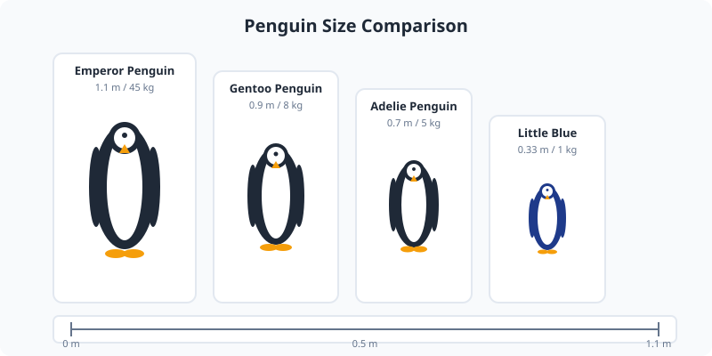

Penguins are a group of aquatic, flightless birds native almost exclusively to the Southern Hemisphere. They are highly adapted for life in the water, with flipper-like wings and streamlined bodies.

<Frame caption="Chinstrap penguin on Deception Island in the South Shetlands. Photo via Wikimedia Commons.">
  
</Frame>

<Frame caption="Illustration: penguin size comparison from emperor to little blue with a height scale bar.">
  
</Frame>

## Species and Size

There are 18 species of penguins. The emperor penguin is the largest, standing over 1.1 meters (3.6 feet) tall and weighing up to 45 kg (99 lb). The little blue penguin is the smallest, averaging about 33 cm (13 inches) in height.

## Adaptations

Penguins have dense, overlapping feathers and a layer of blubber that insulate them in cold water. Their black and white plumage provides camouflage while swimming, a pattern known as countershading.

<Tip>
  Penguins can drink salt water because they have a specialized gland near the eye that filters excess salt from the bloodstream.
</Tip>

## Breeding

Most species nest in colonies ranging from a few hundred to hundreds of thousands of birds. Emperor penguins are famous for breeding during the Antarctic winter, with males incubating eggs on their feet for about two months.
