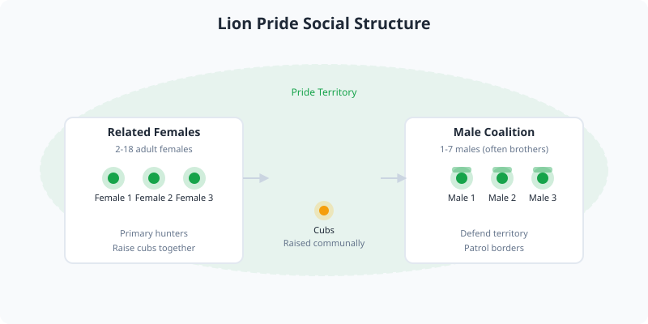

Lions are large felids native to Africa and India. They are the most social of all big cats, living in groups called prides.

<Frame caption="Male lion in the Serengeti National Park. Photo via Wikimedia Commons.">
  
</Frame>

<Frame caption="Illustration: lion pride social structure showing related females, male coalition, and communal cub rearing.">
  
</Frame>

## Appearance

Male lions are distinguished by their prominent manes, which vary in color from blond to black. Adult males typically weigh 150 to 250 kg (330 to 550 lb), while females are smaller, weighing 120 to 180 kg (260 to 400 lb).

## Social Structure

A pride usually consists of related females, their cubs, and a small coalition of males. Females do most of the hunting, often working together to take down prey such as wildebeest, zebra, and buffalo.

<Tip>
  Lions can sleep up to 20 hours a day, conserving energy for nighttime hunts and territorial defense.
</Tip>

## Conservation Status

Lions are listed as vulnerable. Their populations have declined significantly due to human-wildlife conflict, habitat loss, and reduced prey availability.
