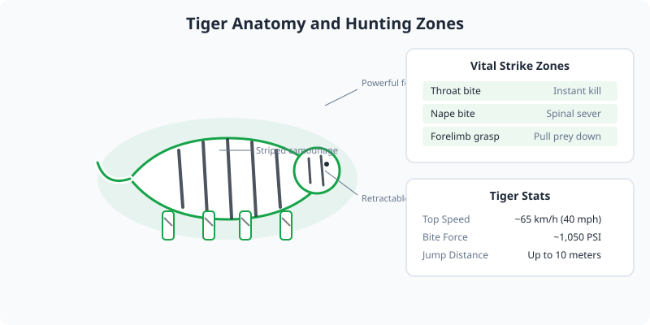

Tigers are the largest living cat species and a member of the genus Panthera. They are easily recognized by their dark vertical stripes on orange fur. Unlike lions, tigers are primarily solitary animals.

<Frame caption="Bengal tiger, a continental tiger subspecies. Photo via Wikimedia Commons.">
  
</Frame>

<Frame caption="Illustration: tiger anatomy, stripe camouflage pattern, vital strike zones, and physical stats.">
  
</Frame>

## Subspecies

There are two recognized subspecies: the continental tiger and the Sunda island tiger. The continental group includes the largest living cats, such as the Siberian and Bengal tigers.

## Hunting and Diet

Tigers are apex predators that rely on stealth and power. They stalk prey before launching a short, explosive charge. Their diet consists mainly of deer, wild boar, and other ungulates.

<AccordionGroup>
  <Accordion title="Swimming ability">
    Unlike most cats, tigers are strong swimmers and are known to cross rivers and lakes while hunting or traveling.
  </Accordion>

  <Accordion title="Roar range">
    A tiger's roar can be heard up to 3 kilometers (1.9 miles) away, used to communicate territory and reproductive status.
  </Accordion>
</AccordionGroup>

## Conservation

Tigers are endangered. Major threats include poaching, habitat fragmentation, and human encroachment. Conservation programs focus on anti-poaching patrols and habitat preservation.
