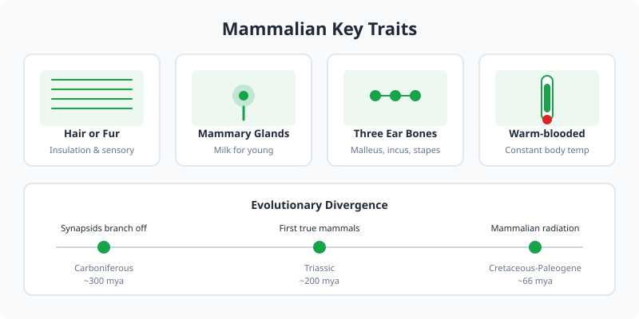

Mammals are a class of warm-blooded vertebrates characterized by the presence of mammary glands, hair or fur, and three middle ear bones. This guide highlights three iconic species.

<Frame caption="Mammals are defined by mammary glands, hair, and three middle ear bones. Photo via Wikimedia Commons.">
  
</Frame>

<Frame caption="Illustration: key mammalian traits and evolutionary timeline from synapsids to modern mammals.">
  
</Frame>

## Featured Species

<CardGroup cols={3}>
  <Card title="Elephants" icon="elephant" href="/animals/mammals/elephants">
    Massive herbivores with trunks and tusks.
  </Card>

  <Card title="Lions" icon="cat" href="/animals/mammals/big-cats/lions">
    Cooperative hunters of the African plains.
  </Card>

  <Card title="Tigers" icon="cat" href="/animals/mammals/big-cats/tigers">
    Stealthy forest and grassland predators.
  </Card>
</CardGroup>

## Key Traits

| Trait | Description |
| --- | --- |
| Warm-blooded | Maintain constant body temperature |
| Hair or fur | Insulation and sensory function |
| Live birth | Most mammals bear live young |
| Milk production | Feed offspring with mammary glands |
