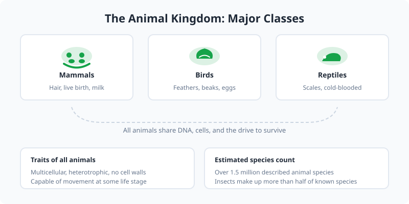

Welcome to the animal guides. This section covers key species across two major classes: mammals and birds. Use the links below to explore detailed profiles.

<Frame caption="The animal kingdom spans millions of species across diverse habitats. Photo via Wikimedia Commons.">
  
</Frame>

<Frame caption="Illustration: major classes of the animal kingdom with key traits and species estimates.">
  
</Frame>

## Mammals

Mammals are warm-blooded vertebrates with hair or fur, and most give live birth.

<CardGroup cols={2}>
  <Card title="Mammals Overview" icon="paw" href="/animals/mammals/overview">
    Meet elephants, lions, and tigers.
  </Card>

  <Card title="Elephants" icon="elephant" href="/animals/mammals/elephants">
    The largest land mammals on Earth.
  </Card>

  <Card title="Lions" icon="cat" href="/animals/mammals/big-cats/lions">
    Social big cats known as kings of the savanna.
  </Card>

  <Card title="Tigers" icon="cat" href="/animals/mammals/big-cats/tigers">
    Solitary apex predators with iconic stripes.
  </Card>
</CardGroup>

## Birds

Birds are feathered, winged vertebrates, most of which are capable of flight.

<CardGroup cols={2}>
  <Card title="Penguins" icon="bird" href="/animals/birds/penguins">
    Flightless seabirds adapted to life in the Southern Hemisphere.
  </Card>

  <Card title="Owls" icon="feather" href="/animals/birds/owls">
    Nocturnal raptors with exceptional hearing and silent flight.
  </Card>
</CardGroup>
