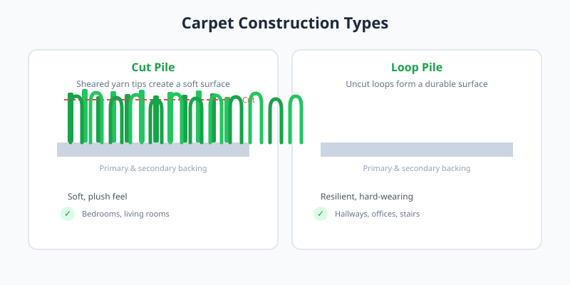

Carpets vary widely in texture, durability, and appearance. The two fundamental pile constructions are **cut pile**, where yarn loops are sheared to create a plush surface, and **loop pile**, where yarns remain uncut to form a tighter, more resilient surface. Understanding these categories helps you match a carpet to the demands of a room.

<Frame caption="A traditional wool carpet showing the pile surface. Photo via Wikimedia Commons.">
  
</Frame>

<Frame caption="Illustration: how cut pile and loop pile differ in construction.">
  
</Frame>

## Cut Pile Carpets

Cut pile carpets are soft underfoot and work well in bedrooms and living areas. The sheared fibers can be twisted tightly for texture or left upright for a velvet finish.

<CardGroup cols={2}>
  <Card title="Saxony" icon="scissors" href="/carpets/pile/cut/saxony">
    Dense, smooth, and formal; best for low-traffic spaces.
  </Card>

  <Card title="Frieze" icon="wind" href="/carpets/pile/cut/frieze">
    Highly twisted, textured, and durable for busy households.
  </Card>
</CardGroup>

## Loop Pile Carpets

Loop pile carpets retain their full yarn loops, making them harder wearing and less likely to show footprints or vacuum marks. They are common in offices and hallways.

<CardGroup cols={2}>
  <Card title="Berber" icon=" grid-2x2" href="/carpets/pile/loop/berber">
    Thick, nubby loops in flecked colors; extremely durable.
  </Card>

  <Card title="Level Loop" icon="layers" href="/carpets/pile/loop/level-loop">
    Uniform loop height for a clean, consistent look.
  </Card>
</CardGroup>

## Handmade Rugs

Beyond broadloom carpet, traditional rugs are woven or knotted by hand. Their regional styles reflect local materials, dyes, and time-honored techniques.

<CardGroup cols={2}>
  <Card title="Persian" icon="gem" href="/carpets/rugs/persian">
    Elaborate floral motifs from Iran, prized for fine knotting.
  </Card>

  <Card title="Moroccan" icon="sun" href="/carpets/rugs/moroccan">
    Bold geometric designs from North African Berber weavers.
  </Card>
</CardGroup>
