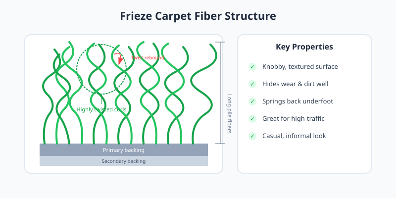

Frieze carpet features long cut-pile fibers twisted so tightly that they curl back on themselves. This creates a knobby, informal texture that hides wear and dirt better than smoother cut piles.

<Frame caption="Illustration: Frieze carpet fibers with tight twists that curl back on themselves.">
  
</Frame>

## Best Uses

Frieze is ideal for active households. It performs well in family rooms, hallways, and stairs where foot traffic is constant. The curled fibers spring back rather than matting flat.

## Care Considerations

<Tip>
  Because the twisted surface camouflages lint and footprints, frieze needs less frequent vacuuming than plush styles. Use a vacuum with adjustable height to avoid snagging long fibers.
</Tip>

The informal look pairs best with casual or contemporary interiors rather than formal settings.
