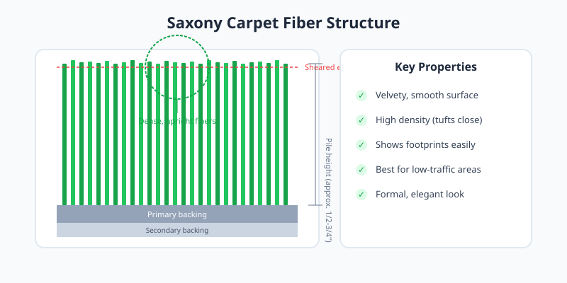

Saxony carpet is a classic cut-pile style made from densely packed, upright yarn tufts. The fibers are sheared to an even height, producing a smooth, velvety surface that feels luxurious underfoot.

<Frame caption="Illustration: Saxony carpet fiber structure with dense, upright sheared tufts.">
  
</Frame>

## Best Uses

Saxony suits formal living rooms, master bedrooms, and other low-traffic areas where comfort and elegance are priorities. Its refined appearance complements traditional decor.

## Care Considerations

<Note>
  Saxony shows footprints and vacuum marks easily due to its upright fibers. Regular gentle vacuuming with a brushless attachment helps maintain a uniform look.
</Note>

Avoid installing Saxony in hallways or children's playrooms. The pile can mat down under heavy use, and once flattened it is difficult to restore.
