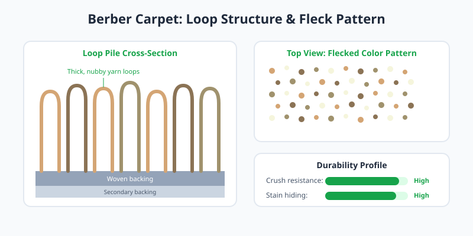

Berber carpet is woven from thick, uncut yarn loops that create a characteristic nubby texture. Traditional Berbers use wool in flecked, neutral tones; modern versions often substitute nylon or olefin for easier maintenance.

<Frame caption="Swatches of Berber carpet showing the flecked color pattern and loop texture. Photo via Wikimedia Commons.">
  
</Frame>

<Frame caption="Illustration: Berber loop structure and flecked color pattern.">
  
</Frame>

## Best Uses

Berber excels in basements, offices, and high-traffic living areas. The tight loop structure resists crushing and absorbs sound effectively. Its multi-tonal flecks help mask soil between cleanings.

## Care Considerations

<Note>
  Snags are the main risk with loop pile. A pulled thread can unzip across the carpet face, so keep pets' claws trimmed and avoid dragging sharp furniture edges.
</Note>

Blot spills immediately; liquid can seep through the loose weave into the backing if left standing.
