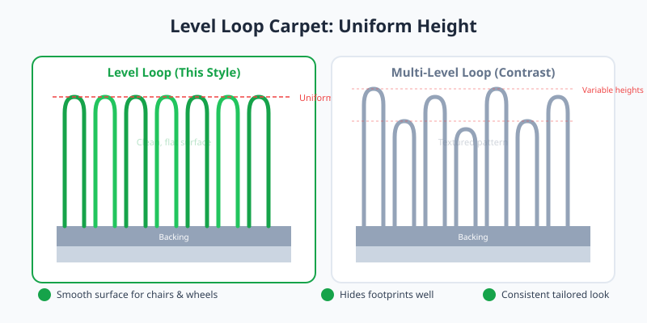

Level loop carpet consists of yarn loops all cut to the same height, creating an even, low-profile surface. Unlike textured loop styles, there is no variation in pile level, giving the floor a clean, tailored appearance.

<Frame caption="Illustration: Level loop carpet with uniform loop height compared to multi-level loop.">
  
</Frame>

## Best Uses

This style is common in commercial settings, home offices, and contemporary interiors. The flat surface allows desk chairs and furniture to move easily without catching.

## Care Considerations

<Tip>
  Level loop hides footprints and vacuum tracks well. For maintenance, vacuum regularly with a suction-only model or a beater-bar set high enough to avoid fraying the loops.
</Tip>

Because all loops share the same height, any damage from a snag is more visible than on multi-level loop carpets. Prompt repair of pulled loops preserves the uniform look.
