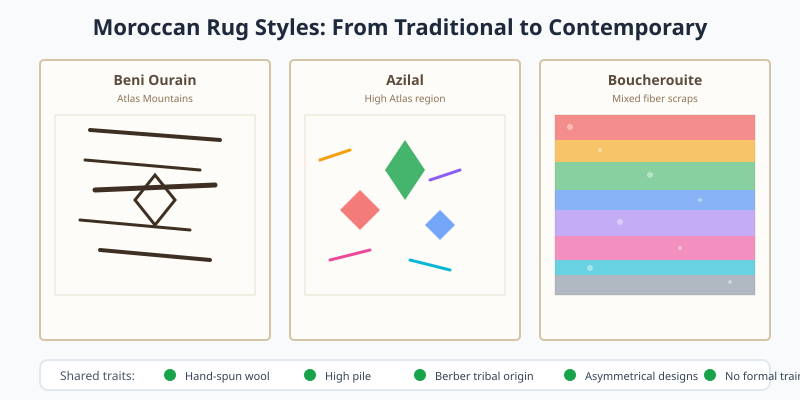

Moroccan rugs are woven by Berber tribes across Morocco using techniques passed down through generations. They are characterized by abstract geometric motifs, high pile, and an organic, often asymmetrical composition.

<Frame caption="Illustration: three Moroccan rug styles - Beni Ourain, Azilal, and Boucherouite - with their distinctive patterns and shared traits.">
  
</Frame>

## Craft and Materials

Most Moroccan rugs use hand-spun wool from local sheep. Beni Ourain rugs, perhaps the best known subtype, feature a cream or ivory background with dark, irregular geometric lines. Other styles, such as Azilal and Boucherouite, incorporate color and mixed materials.

## Styling Notes

<CardGroup>
  <Card title="Beni Ourain" icon="mountain">
    Minimalist palettes suit modern and Scandinavian interiors.
  </Card>

  <Card title="Boucherouite" icon="palette">
    Made from fabric scraps; vibrant and ecologically mindful.
  </Card>
</CardGroup>

Shake out or gently vacuum Moroccan rugs on a low setting. Because many are thick and loosely knotted, professional cleaning every few years helps preserve the wool fibers.
