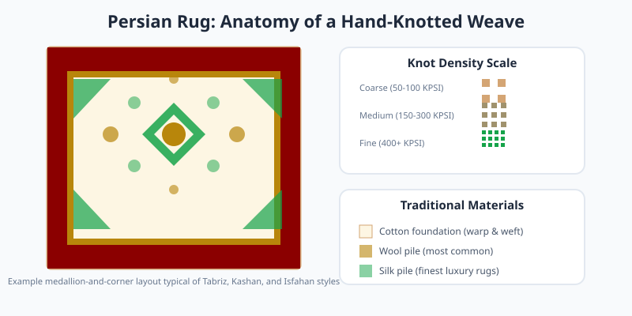

Persian rugs are hand-knotted textiles produced primarily in Iran. They are distinguished by dense knot counts, elaborate floral or medallion patterns, and a color palette drawn from natural vegetable dyes.

<Frame caption="Detail of a historic Persian carpet from the Louvre collection showing intricate knotting. Photo via Wikimedia Commons.">
  
</Frame>

<Frame caption="Illustration: anatomy of a Persian rug with medallion layout and knot density scale.">
  
</Frame>

## Craft and Materials

Weavers tie individual knots onto a cotton, wool, or silk foundation. Higher knot density, measured in knots per square inch, generally indicates finer detail and greater durability. A single room-sized rug can take months or years to complete.

## Regional Styles

<Pill>Tabriz, Kashan, Isfahan, and Heriz are among the most recognized regional names, each with signature motifs and weaving techniques.</Pill>

Authentic Persian rugs appreciate in value when well maintained. Avoid direct sunlight to prevent fading, and rotate the rug annually so wear distributes evenly.
