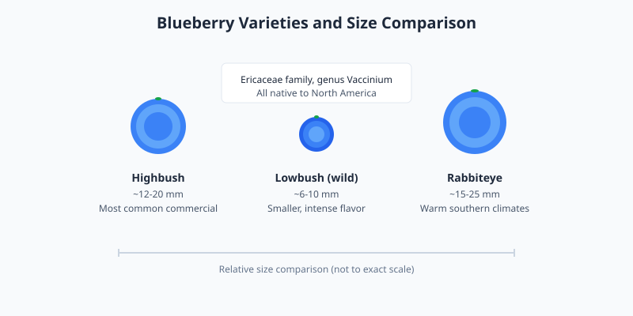

Blueberries are small, round berries that grow on shrubs in the Ericaceae family. They are native to North America and are now cultivated in many temperate regions. Their deep blue color comes from anthocyanins, natural pigments with antioxidant properties.

<Frame caption="A cluster of fresh blueberries. Photo via Wikimedia Commons.">
  
</Frame>

## Varieties

Highbush blueberries are the most common commercial type, while lowbush (wild) blueberries are smaller and more intensely flavored. Rabbiteye blueberries are adapted to warmer southern climates.

## Nutrition and storage

Blueberries are low in calories and a source of fiber and vitamin C. They are often eaten fresh, frozen, or added to cereals, baked goods, and smoothies. Store fresh blueberries unwashed in the refrigerator and rinse just before eating.

<Frame caption="Illustration: blueberry varieties and size comparison showing highbush, lowbush (wild), and rabbiteye types.">
  
</Frame>

<Note>
  Frozen blueberries retain most of their nutritional value and work well in smoothies, oatmeal, and baking.
</Note>
