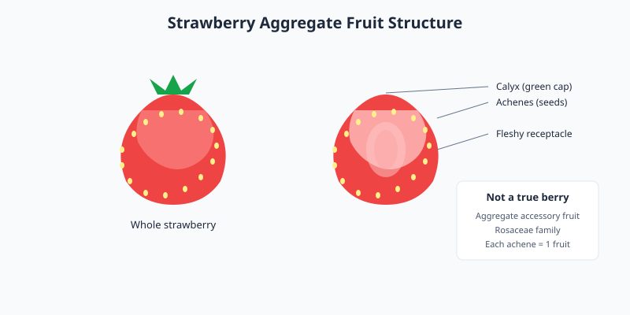

Strawberries are bright red, juicy fruits that belong to the Rosaceae family. Despite their name, they are not true berries botanically; they are aggregate accessory fruits. They are widely grown in temperate climates and enjoyed fresh or processed.

<Frame caption="A single garden strawberry showing its bright red color and external seeds. Photo via Wikimedia Commons.">
  
</Frame>

## Culinary uses

Strawberries are eaten fresh, added to salads, blended into smoothies, baked into pastries, and cooked into jams and sauces. Their natural sweetness and slight acidity make them versatile in both sweet and savory dishes.

## Storage tips

Store fresh strawberries in the refrigerator and wash them just before use to prevent premature spoilage. Remove any bruised or moldy berries promptly to protect the rest of the container.

<Frame caption="Illustration: strawberry aggregate fruit structure showing the fleshy receptacle, external achenes, and calyx.">
  
</Frame>

<Tip>
  Hull strawberries with a paring knife or a huller to remove the green cap and white core while preserving as much fruit as possible.
</Tip>
