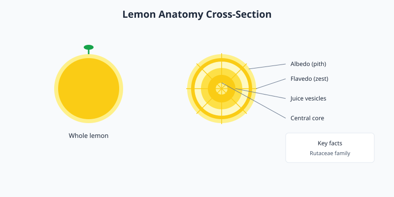

Lemons are oval-shaped citrus fruits known for their bright yellow color and tart, acidic juice. They belong to the Rutaceae family and thrive in warm, subtropical climates. And lemons. 

<Frame caption="A whole lemon with foliage. Photo via Wikimedia Commons.">
  
</Frame>

## Culinary uses

Lemon juice and zest add acidity and brightness to dishes. Common uses include salad dressings, marinades, sauces, baked goods, and beverages like lemonade. The juice also prevents oxidation in sliced fruits.

## Nutrition and storage

Lemons are a good source of vitamin C and contain beneficial plant compounds. Store fresh lemons at room temperature for about a week, or refrigerate them for up to a month to extend freshness.

<Frame caption="Illustration: lemon anatomy cross-section showing the zest, pith, juice vesicles, and central core.">
  
</Frame>

<Tip>
  Roll a lemon on the counter before juicing to break down internal membranes and extract more juice.
</Tip>
