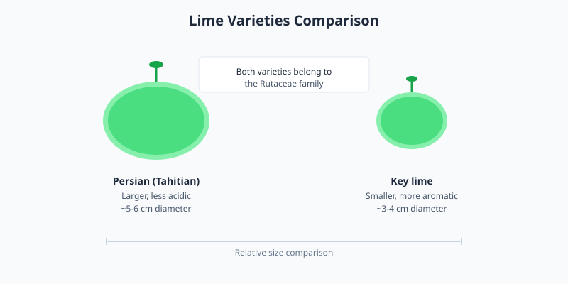

Limes are small, round citrus fruits with a green rind and acidic juice. They are widely used in cooking and beverages across many cuisines, particularly in Latin American, Southeast Asian, and Middle Eastern dishes.

<Frame caption="Key limes on a branch. Photo via Wikimedia Commons.">
  
</Frame>

## Varieties and flavor

Common varieties include Persian (Tahitian) limes and Key limes. Persian limes are larger and less acidic, while Key limes are smaller, more aromatic, and intensely tart. Both deliver a sharp, refreshing flavor.

## Selection and storage

Choose limes that feel heavy for their size and have smooth, glossy skin. Store them at room temperature for a few days or refrigerate for up to two weeks to maintain juiciness.

<Frame caption="Illustration: size and shape comparison between Persian (Tahitian) and Key lime varieties.">
  
</Frame>

<Note>
  Fresh lime juice is significantly more flavorful than bottled juice and is preferred for most recipes.
</Note>
