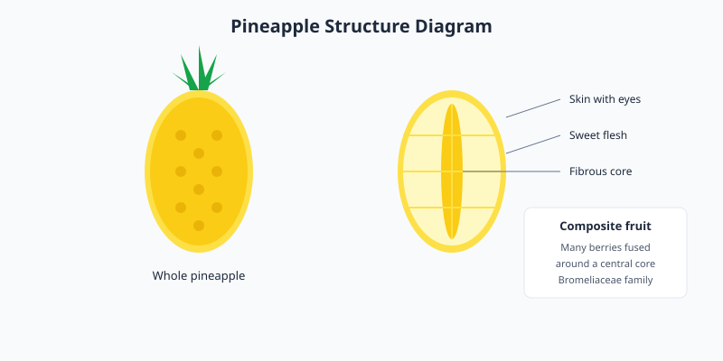

Pineapples are tropical fruits with a tough, spiky exterior and juicy, yellow flesh. They belong to the Bromeliaceae family and are native to South America. Today they are cultivated in tropical regions worldwide.

<Frame caption="A ripe whole pineapple. Photo via Wikimedia Commons.">
  
</Frame>

## Structure and flavor

A pineapple is a composite fruit made of many berries fused around a central core. The flesh is sweet and tangy, with a firm, fibrous texture. The core is edible but tougher than the surrounding flesh.

## Selection and preparation

Select pineapples with a sweet fragrance at the base and fresh, green leaves. A ripe pineapple yields slightly when squeezed. To prepare, cut off the top and bottom, slice away the skin, remove the eyes, and cut around the core.

<Frame caption="Illustration: pineapple structure diagram showing the whole fruit and a cross-section with the central core and fused berry segments.">
  
</Frame>

<Note>
  Pineapples do not ripen significantly after harvest, so choose a fragrant, yielding fruit at the store.
</Note>
