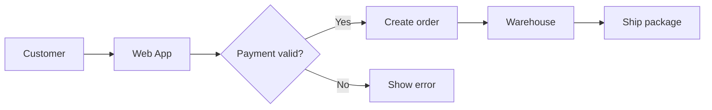
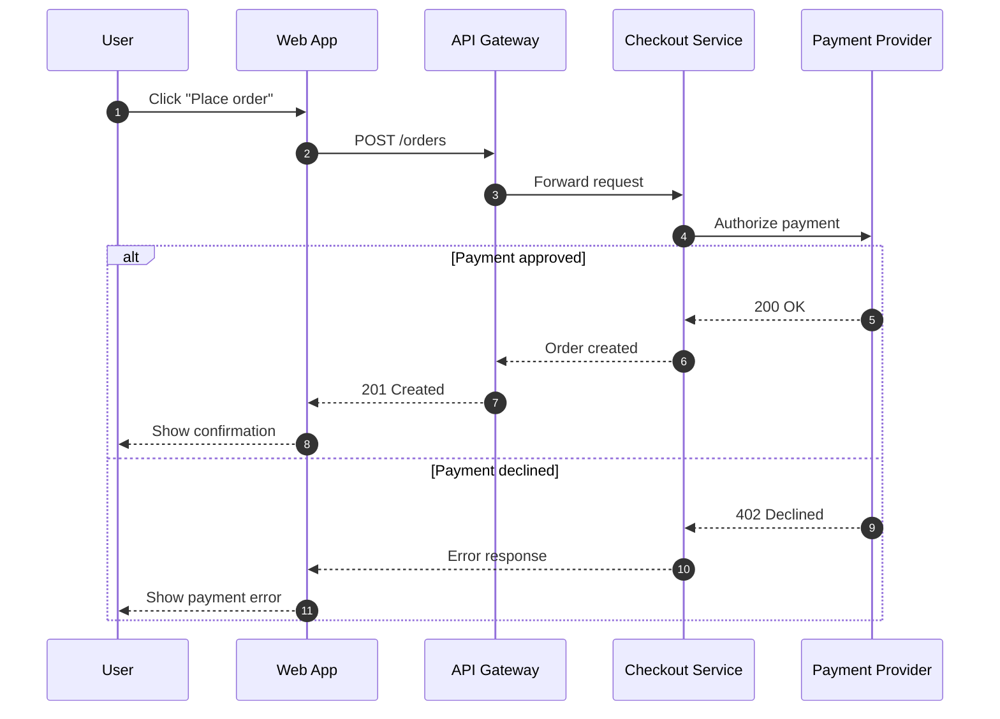
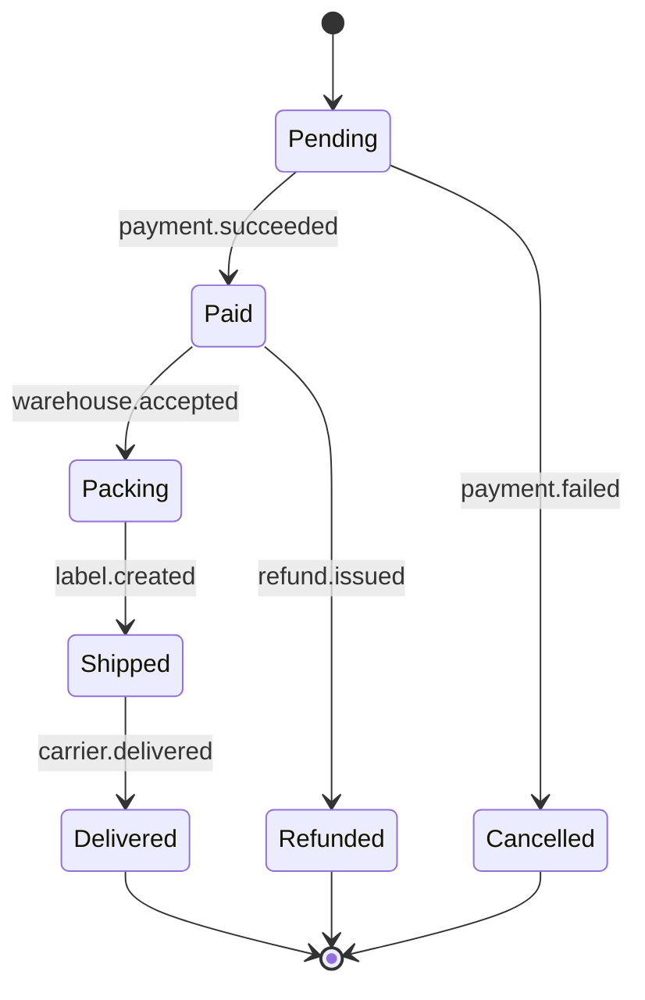
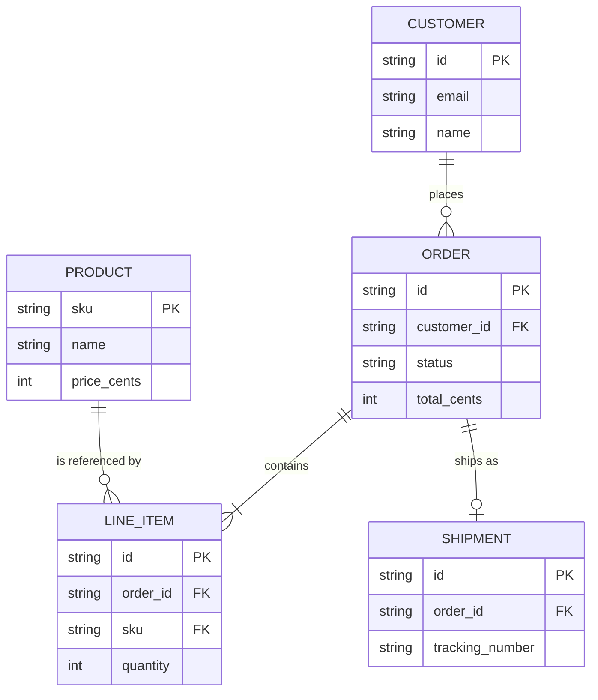
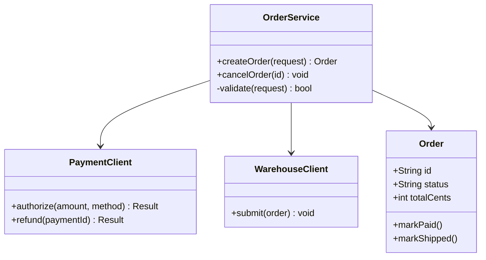
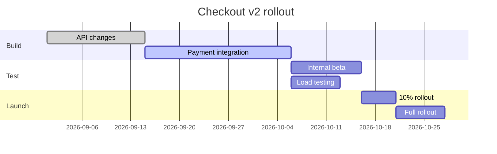
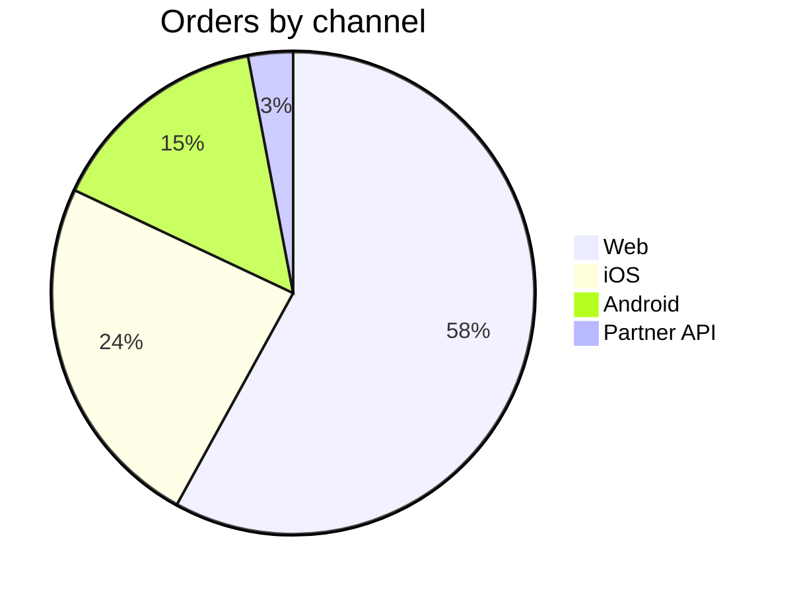
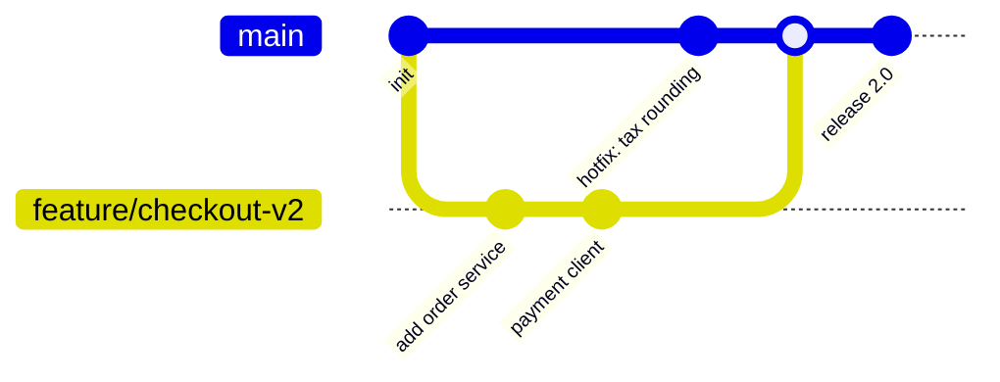
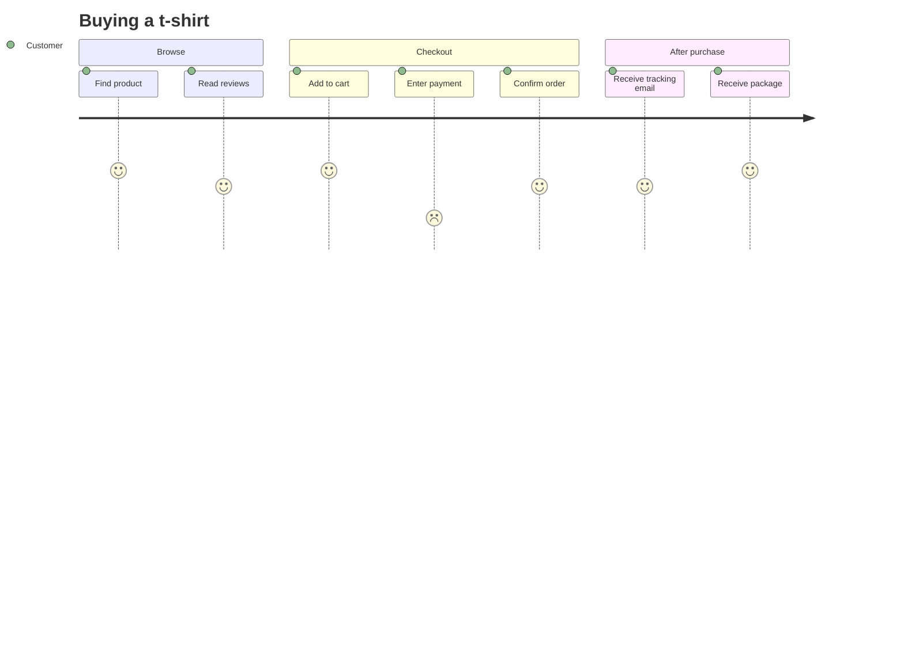

This page walks through how an order moves through a sample checkout service. It mixes several Mermaid diagram types with regular documentation content so you can see how diagrams render alongside text, callouts, tables, and code.

## Overview aefjaewf

The checkout service accepts orders from the web app, validates payment, and hands fulfilled orders to the warehouse. At a high level, the flow looks like this:



<Note>
  All services communicate over HTTPS. Internal calls use short-lived service tokens.
</Note>

## Request lifecycle

When a customer clicks **Place order**, the web app sends a request to the API gateway. The gateway authenticates the request and forwards it to the checkout service, which calls the payment provider before confirming.



A typical request body looks like this:

```json POST /orders
{
  "customer_id": "cus_8421",
  "items": [
    { "sku": "TSHIRT-BLK-M", "quantity": 2 },
    { "sku": "MUG-WHT", "quantity": 1 }
  ],
  "payment_method": "pm_card_visa"
}
```

## Order states

Every order moves through a fixed set of states. Transitions are triggered by events from the payment provider and the warehouse.



| State | Description | Customer visible |
| --- | --- | --- |
| `Pending` | Order created, waiting on payment | Yes |
| `Paid` | Payment captured | Yes |
| `Packing` | Warehouse is preparing items | Yes |
| `Shipped` | Package handed to carrier | Yes |
| `Delivered` | Carrier confirmed delivery | Yes |
| `Cancelled` | Payment failed or customer cancelled | Yes |
| `Refunded` | Funds returned to customer | Yes |

<Tip>
  Subscribe to the `order.updated` webhook to react to state changes instead of polling.
</Tip>

## Data model

Orders, customers, and line items are stored in a relational database. The diagram below shows how they relate.



## Service classes

The checkout service is organized into a few core classes. Each class owns a single responsibility.



<Accordion title="Why separate the payment client?">
  Keeping payment logic in its own client makes it easy to swap providers or add a second provider for failover without touching order logic.
</Accordion>

## Rollout plan

The new checkout flow ships in phases over the next quarter.



<Steps>
  <Step title="Enable the feature flag">
    Turn on `checkout_v2` for internal accounts in the admin panel.
  </Step>
  <Step title="Monitor error rates">
    Watch the checkout dashboard for payment and order errors during beta.
  </Step>
  <Step title="Expand rollout">
    Increase traffic to 10%, then 100% once error rates stay below 0.1%.
  </Step>
</Steps>

## Traffic breakdown

Most orders come from the web app today, but mobile usage is growing quickly.



## Release history



## Customer journey



<Warning>
  The payment step has the lowest satisfaction score. Saved payment methods are planned for Q1 to reduce friction.
</Warning>

## End-to-end pipeline

The full pipeline from cart to delivery spans many services. This diagram is intentionally wide so you can see how long horizontal flows render.

```mermaid
flowchart LR
  A[Cart updated by customer in the web or mobile app] ----> B[API gateway authenticates and rate limits the request] ----> C[Checkout service validates inventory, pricing, and tax] ----> D[Payment provider authorizes and captures the full amount] ----> E[Order service persists the order and emits order.created] ----> F[Warehouse service reserves stock and schedules packing] ----> G[Shipping service purchases a label from the carrier] ----> H[Notification service emails tracking details to the customer] ----> I[Carrier delivers the package and confirms delivery]
```



## Next steps

<CardGroup cols={2}>
  <Card title="Quickstart" icon="rocket" href="/quickstart">
    Set up your environment and place a test order.
  </Card>

  <Card title="Home" icon="house" href="/">
    Return to the documentation home page.
  </Card>
</CardGroup>
