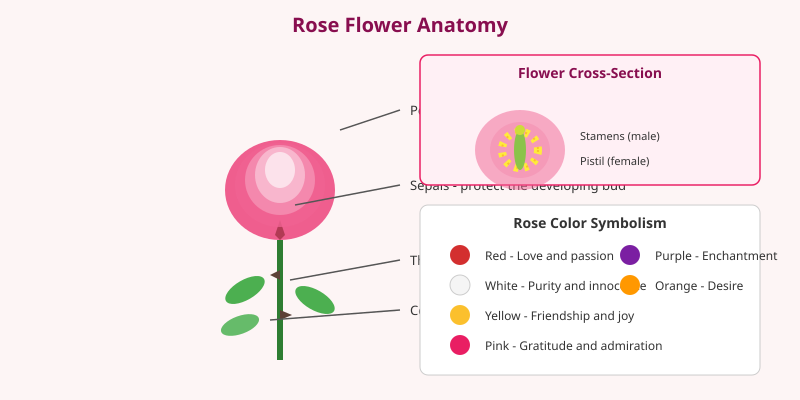

Roses are flowering plants in the genus _Rosa_, with over 300 species and tens of thousands of cultivated varieties. They are one of the most popular ornamental plants in the world and carry deep cultural meaning across societies.

<Frame caption="A sweet briar rose (_Rosa rubiginosa_) in bloom, showing the layered petals typical of the genus. Photo via Wikimedia Commons.">
  
</Frame>

## Cultivation

Roses are grown for gardens, cut flowers, and perfumes. Hybrid tea roses and floribundas are common garden choices. They prefer well-drained soil, full sun, and regular pruning to encourage healthy blooms and airflow.

## Cultural Significance

Roses have long symbolized love, beauty, and politics. Different colors carry distinct meanings: red for love, white for purity, and yellow for friendship. The rose is the national flower of the United States and the United Kingdom.

<Frame caption="Illustration: Rose flower anatomy with labeled petals, sepals, thorns, and a cross-section showing reproductive parts, plus color symbolism chart.">
  
</Frame>

<Tip>
  When planting roses, leave space between bushes to reduce the risk of fungal diseases like black spot and powdery mildew.
</Tip>
