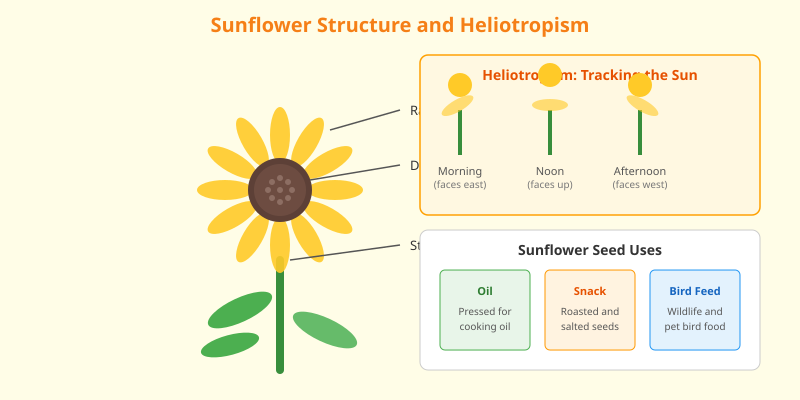

Sunflowers are tall annual plants in the genus _Helianthus_, best known for the common sunflower (_Helianthus annuus_). Native to North America, they are grown worldwide for their striking blooms and valuable seeds.

<Frame caption="A common sunflower (_Helianthus annuus_) with bright yellow ray florets against a blue sky. Photo via Wikimedia Commons.">
  
</Frame>

## Growth Habit

Young sunflowers exhibit heliotropism, turning their flower heads to track the sun from east to west during the day. Mature blooms typically face east. Sunflowers can grow several meters tall in a single season.

## Agricultural Value

Sunflower seeds are consumed as snacks, pressed for oil, and used as bird feed. Sunflower oil is a common cooking oil valued for its mild flavor and high smoke point. The plants are also used in phytoremediation to extract contaminants from soil.

<Frame caption="Illustration: Sunflower structure showing ray and disk florets, heliotropism across morning, noon, and afternoon, and seed uses.">
  
</Frame>

<AccordionGroup>
  <Accordion title="Fun fact">
    The flower head of a sunflower is actually a composite of many small florets, with ray florets around the edge and disk florets in the center.
  </Accordion>

  <Accordion title="Planting tip">
    Sunflowers need full sun, consistent moisture, and shelter from strong winds to prevent tall stems from toppling.
  </Accordion>
</AccordionGroup>
