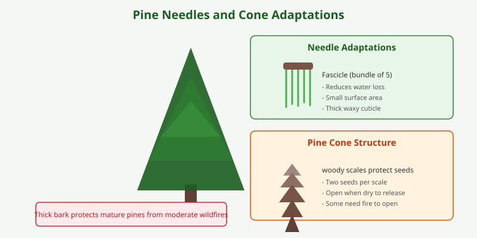

Pine trees are evergreen conifers in the genus _Pinus_, with over 100 species distributed mostly in the Northern Hemisphere. They are recognized by their bundles of needle-like leaves and woody cones.

<Frame caption="A Jeffrey pine (_Pinus jeffreyi_) growing in Lassen Volcanic National Park. Photo via Wikimedia Commons.">
  
</Frame>

## Adaptations

Pines are well-adapted to cold and dry conditions. Their needle-shaped leaves reduce water loss, and their flexible branches shed heavy snow. Thick bark protects mature trees from moderate wildfires.

## Uses

Pine wood is widely used in construction, paper production, and furniture. Resin harvested from pines contributes to products like turpentine, rosin, and certain adhesives. Pine nuts, harvested from specific species, are also used in cooking.

<Frame caption="Illustration: Pine needle bundle adaptations and pine cone structure with labeled parts.">
  
</Frame>

<Note>
  Pine needles are slightly acidic; as they decompose, they can lower soil pH over time, influencing which understory plants grow nearby.
</Note>
