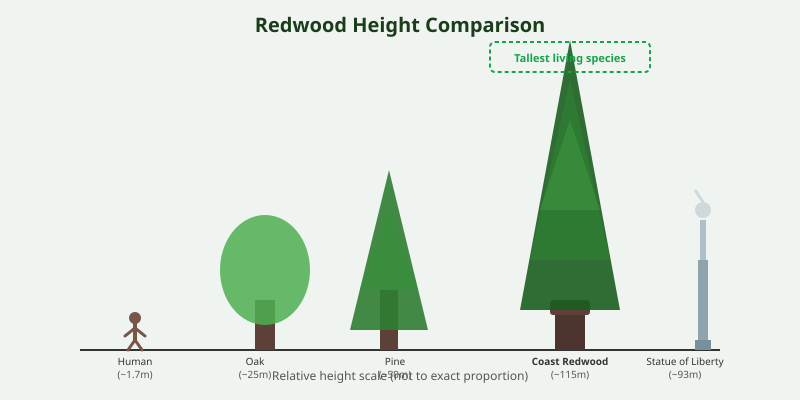

Redwoods are massive conifers native to the coastal fog belt of Northern California and southern Oregon in the United States. The three surviving species are the coast redwood, the giant sequoia, and the dawn redwood.

<Frame caption="Towering coast redwoods (_Sequoia sempervirens_) along US 199, the Redwood Highway. Photo via Wikimedia Commons.">
  
</Frame>

## Record Heights

The coast redwood (_Sequoia sempervirens_) includes the tallest known living trees on Earth, with the record holder exceeding 115 meters in height. These trees can live for more than 2,000 years.

## Conservation

Old-growth redwood forests were heavily logged from the 19th through mid-20th centuries. Preservation efforts, including the establishment of Redwood National and State Parks, have helped protect remaining stands and support regeneration.

<Frame caption="Illustration: Height comparison of a human, oak, pine, Statue of Liberty, and coast redwood showing relative scale.">
  
</Frame>

<CardGroup cols={2}>
  <Card title="Fact" icon="leaf">
    Redwood bark can be more than 30 centimeters thick and contains tannins that help resist fire and insects.
  </Card>

  <Card title="Fact" icon="leaf">
    Redwoods absorb much of their moisture from coastal fog through their needles and bark.
  </Card>
</CardGroup>
