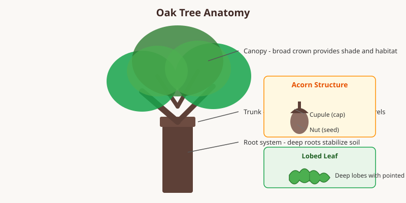

Oak trees belong to the genus _Quercus_ and include hundreds of species found across the Northern Hemisphere. They are deciduous or evergreen hardwoods valued for their timber, acorns, and role in forest ecosystems.

<Frame caption="An English oak (_Quercus robur_) with broad spreading branches. Photo via Wikimedia Commons.">
  
</Frame>

## Characteristics

Oaks typically have lobed leaves and produce acorns, a nut that feeds wildlife such as squirrels and deer. Their wood is dense, durable, and resistant to rot, making it a preferred material for furniture, flooring, and barrels.

## Ecological Importance

Oak forests support thousands of species, including insects, birds, and mammals. The trees improve soil health through leaf litter and deep root systems. Many oak species can live for several centuries, making them long-standing anchors of their habitats.

<Frame caption="Illustration: Oak tree anatomy showing canopy, trunk, roots, acorn structure, and lobed leaf shape.">
  
</Frame>

<Tip>
  Oak bark and acorns have historically been used in tanning leather and as a food source after proper processing to remove tannins.
</Tip>
